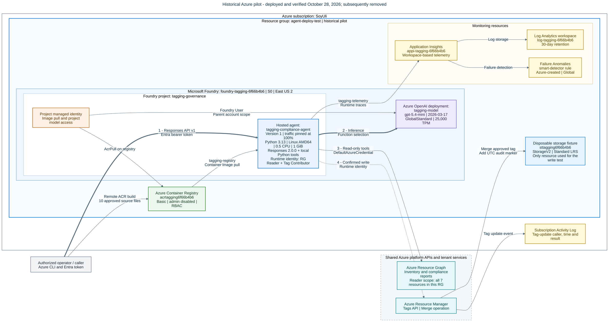

# Azure Architecture: Tagging Compliance Agent

**Resource group:** `agent-deploy-test`  
**Subscription:** SoyUli (`de40fdb3-141c-427b-bea2-3519781af333`)  
**Tenant:** Default Directory (`ulisesadanhotmail.onmicrosoft.com`)  
**Region:** East US 2; the automatically created smart-detector alert rule was global  
**Historical ARM resource count:** 7  
**Verified / documented:** October 28, 2026  
**Current status:** Removed after successful verification, with explicit approval. This is the architecture of the tested deployment, not a live resource inventory.

## Overview

The solution hosted the existing Python tagging-compliance agent in Microsoft Foundry. An authorized caller used the agent's Responses endpoint to request a compliance report, review a proposed change, and confirm an exact resource/tag update. The hosted container used an Azure OpenAI model for reasoning and function selection; the Python tools performed the actual Resource Graph queries and ARM tag merges.

The pilot used one resource group for both the application infrastructure and its disposable storage fixture. The agent's runtime identity had Reader and Tag Contributor only on that group, not on the subscription. Image-pull/project inference permissions used the separate Foundry project managed identity. Application Insights, a Log Analytics workspace, and the subscription Activity Log supplied operational and change evidence.

The retained deployment report and pre-cleanup ARM inventory establish the historical topology. The deployment commands and validation results are documented in [the CLI guide](deployment-cli.md#live-verification). No Azure resources were recreated to produce this diagram.

## Resource inventory

These are the seven ARM resources present before cleanup. The model deployment, hosted agent, connections, identities, and shared platform APIs are detailed separately; they are not additional rows in this captured resource count.

| Resource | Azure type | Configuration verified for the pilot | Location |
|---|---|---|---|
| `foundry-tagging-6f66b4b6` | `Microsoft.CognitiveServices/accounts` | Microsoft Foundry account; `AIServices`, S0; system-assigned identity | East US 2 |
| `foundry-tagging-6f66b4b6/tagging-governance` | `Microsoft.CognitiveServices/accounts/projects` | Foundry project; its own system-assigned identity; registry and telemetry connections | East US 2 |
| `acrtagging6f66b4b6` | `Microsoft.ContainerRegistry/registries` | Basic; admin disabled; classic RBAC mode; remote Linux AMD64 build | East US 2 |
| `log-tagging-6f66b4b6` | `Microsoft.OperationalInsights/workspaces` | Workspace backing Application Insights; 30-day retention; SKU not recorded in the generic inventory | East US 2 |
| `appi-tagging-6f66b4b6` | `Microsoft.Insights/components` | Workspace-based Application Insights; `web` kind | East US 2 |
| `sttagging6f66b4b6` | `Microsoft.Storage/storageAccounts` | Disposable tag-write fixture; StorageV2, Standard LRS; HTTPS/TLS 1.2; shared-key and public-blob access disabled | East US 2 |
| `Failure Anomalies - appi-tagging-6f66b4b6` | `Microsoft.AlertsManagement/smartDetectorAlertRules` | Azure-created failure-anomaly monitoring rule associated with Application Insights | Global |

### Foundry components

| Component | Tested configuration |
|---|---|
| Model deployment | `tagging-model`: `gpt-5.4-mini`, version `2026-03-17`; GlobalStandard, capacity 25; 25,000 tokens/minute and 25 requests/minute |
| Hosted agent | `tagging-compliance-agent`, version 1; endpoint pinned at 100%; 0.5 CPU, 1 GiB; Python 3.13 / Linux AMD64 |
| Protocol | Foundry API `v1`; hosted Responses protocol `2.0.0` |
| Registry connection | `tagging-registry`: ContainerRegistry category, ManagedIdentity authentication |
| Telemetry connection | `tagging-telemetry`: AppInsights category, ApiKey authentication using the component connection string; secret value omitted |
| Container image | `acrtagging6f66b4b6.azurecr.io/tagging-compliance-agent:release-6f66b4b6` |
| Image digest | `sha256:78df6da75f21dd5a44b0a7a1d6a23d02c40c92de3d31e1edec40932f920969fd` |

## Architecture diagram

[Open the scalable SVG diagram](agent-deploy-test-architecture.svg).

Editable Mermaid source

**Legend:** Thick arrows identify the caller/model path. Solid arrows show deployment, data, identity, or monitoring relationships. The dashed write path is conditional on explicit confirmation and write permission. The runtime identity and its group-only roles appear inside the hosted-agent box; the separate project identity has its own node. Entra authentication, Resource Graph, ARM, and Activity Log are platform services, not extra resources provisioned in the group.

## Relationship details

### Build and deployment

1. The operator uploaded only the ten approved build inputs to ACR Tasks. The build used the shipped Dockerfile and frozen dependency lock; no local Docker installation was required.
2. Foundry used the project's managed identity and its AcrPull assignment to obtain the image through `tagging-registry`.
3. The hosted agent ran inside the Foundry project. Version 1 was selected for 100% of endpoint traffic. No customer AKS cluster, Container Apps environment, VM, or App Service was provisioned.

### Request, reporting, and write flow

1. The authorized caller obtained an Entra token for `https://ai.azure.com` and called the hosted Responses endpoint. No separate end-user web application or API gateway was deployed.
2. The agent used `FoundryChatClient` and `tagging-model` to interpret the request and choose Python functions.
3. The reporting tools queried Azure Resource Graph's **Resources** table. They explicitly filtered to `agent-deploy-test`; the runtime identity's group-scoped Reader role bounded resource visibility. Resource-group objects themselves were not scored.
4. The operator reviewed a proposal and confirmed the exact storage resource, `Application_Name=Tagging Agent Pilot`, and automatic audit tag in the same conversation.
5. The single-resource tool called the ARM Tags API with **Merge**, preserving existing non-empty values and adding `Tagged_By_Agent=tagging-compliance-agent@<UTC timestamp>` on an actual write.
6. ARM tags and the subscription Activity Log confirmed the update. A same-value retry returned an already-set skip and did not replace the original audit marker.

| Packaged tool | Purpose | Live exercise |
|---|---|---|
| `get_tag_report` | Counts and per-tag percentages | Verified |
| `list_non_compliant` | Resource IDs, missing/invalid tags, and sibling examples | Verified |
| `apply_resource_tags` | Additive tag merge on one resource | Verified on the disposable fixture |
| `apply_tags_to_resource_group` | Additive merge across resources inside a group | Packaged, but not tested or approved for this combined infrastructure/test group |

### Identity and access boundaries

| Identity / actor | Scope and role | Responsibility |
|---|---|---|
| Deployment operator / role administrator | Existing bootstrap rights; Foundry Project Manager at project scope | Provision resources, create scoped assignments, register/invoke the hosted agent |
| Foundry project managed identity | AcrPull on `acrtagging6f66b4b6`; Foundry User on the parent Foundry account | Registry pull and project model access |
| Agent runtime instance identity | Reader and Tag Contributor on `agent-deploy-test` only | Resource inventory and approved tag changes |
| Foundry account system identity | Enabled on the account | Retained inventory confirms its existence; no extra data-access role flow is inferred |

The runtime identity was **not** the project managed identity and had no subscription-wide governance assignment, Owner, or Contributor. Reader covered all seven resources in the group. Tag Contributor also covered the group, although the accepted write request targeted only the fixture.

Confirmation was implemented by agent instructions, not by a separate approval service. RBAC was the enforceable Azure boundary; the code did not contain a fixed resource-group allow-list.

### Telemetry and audit

- The project connection `tagging-telemetry` linked the agent to Application Insights, backed by `log-tagging-6f66b4b6`.
- Runtime traces, requests, dependencies, and exception records were observed. Exception records included early model-throttling failures.
- Azure automatically added the global Failure Anomalies smart-detector rule. This increased the scored inventory from six resources to seven.
- The Activity Log attributed the successful tag write to the runtime agent identity.
- The storage account was a **taggable test target**, not an audit-data store. The agent's CSV audit file remained container-local and ephemeral; no durable CSV export was deployed.
- All secret values are omitted. `APPLICATION_INSIGHTS_CONNECTION_STRING` is a placeholder for the connection credential, not an exposed value.

### Network and regional boundaries

The pilot used public Azure HTTPS endpoints with Entra authentication. No customer VNet, private endpoint, network-isolated execution host, Key Vault, scheduler, or notification pipeline was deployed.

The account/project, registry, workspace, Application Insights component, and fixture were in East US 2. The smart-detector rule was global. **GlobalStandard model processing is not restricted to the resource region**; this diagram does not establish a production data-residency guarantee.

## Verification and operational notes

- Both reporting tools matched a separate Resource Graph query. The final inventory contained seven scored resources and zero exclusions.
- Only the storage fixture received the test's application tag and audit marker. Existing description and baseline infrastructure tags were preserved.
- The fixture's Application_Name became compliant, producing 14.3% group compliance for that tag. All seven resources remained overall non-compliant because other required tags were missing.
- Capacity 5 hit the model's token-rate limit. The approved capacity 25 and a separate post-write report after rate-window refresh completed the test. A failed model reply did not necessarily mean its preceding tag write had failed.
- Governance must reconcile the prose naming convention with the runtime's all-eight-tag requirement before production use.
- Bulk writes, a different-value overwrite attempt, portal UI actions, private networking, and subscription-wide reporting were not live-tested.
- Cleanup removed the hosted agent and all blocking sessions, both runtime governance assignments, and the resource group. The diagram is historical; redeploy using a guide rather than treating these endpoints as live.

## Related documentation

- [CLI deployment and verified results](deployment-cli.md)
- [Portal and embedded Cloud Shell deployment](deployment-portal.md)
- [Hosted entry point](../tagging-compliance-agent/src/agent-framework-agent-with-local-tools-responses/main.py)
- [Python tools](../tagging-compliance-agent/src/agent-framework-agent-with-local-tools-responses/tools.py)
- [Runtime rules](../tagging-compliance-agent/src/agent-framework-agent-with-local-tools-responses/rules.json)
